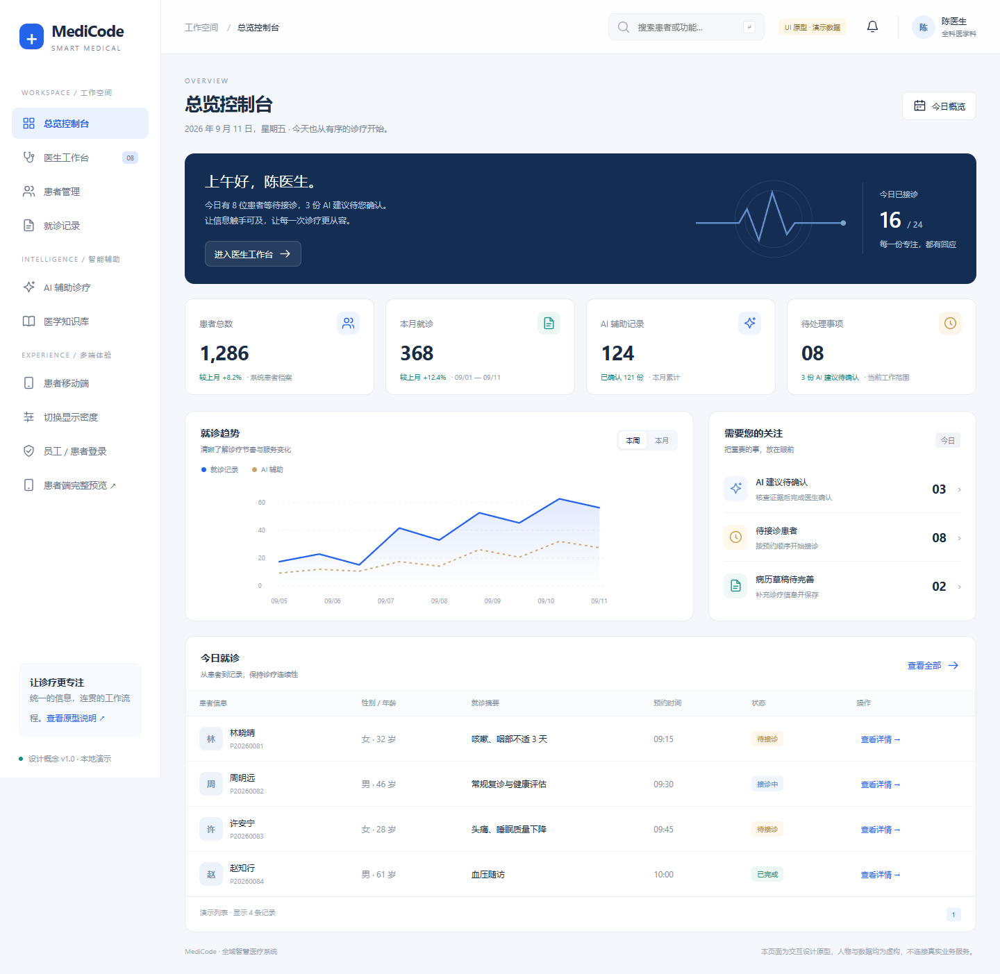
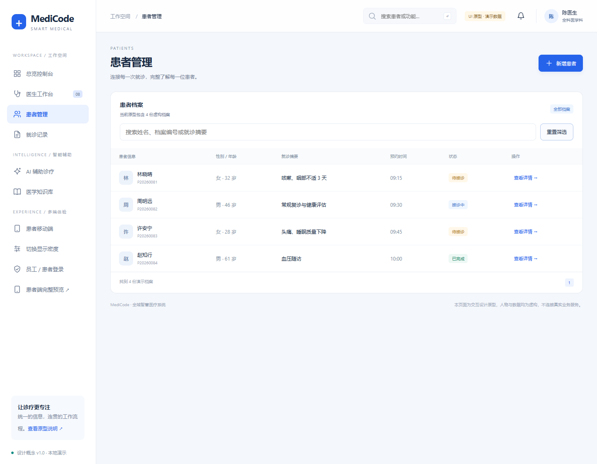
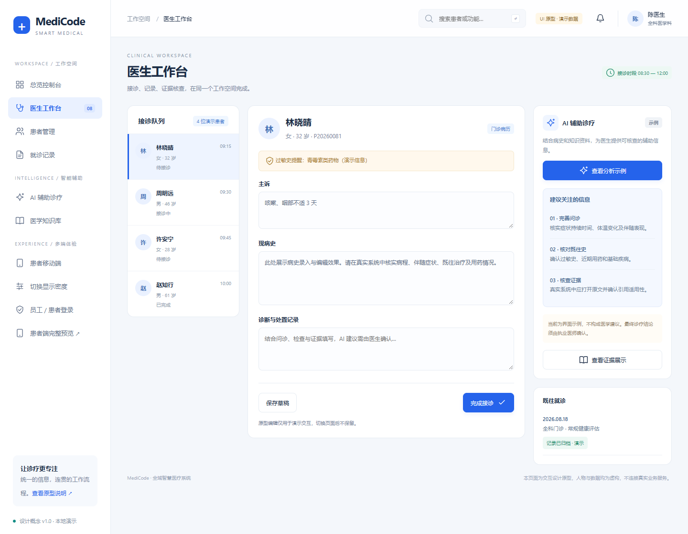
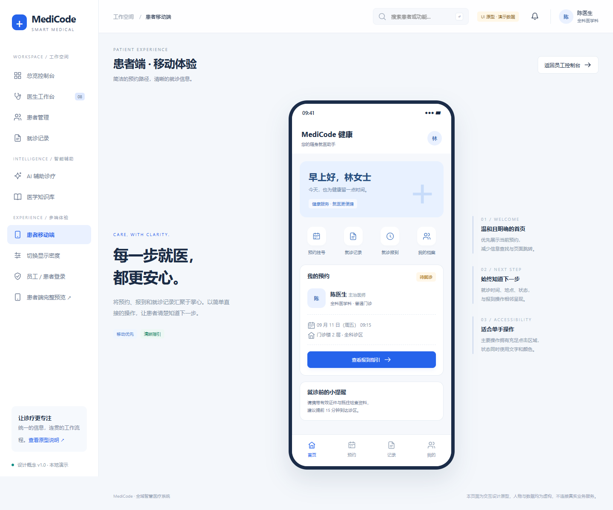
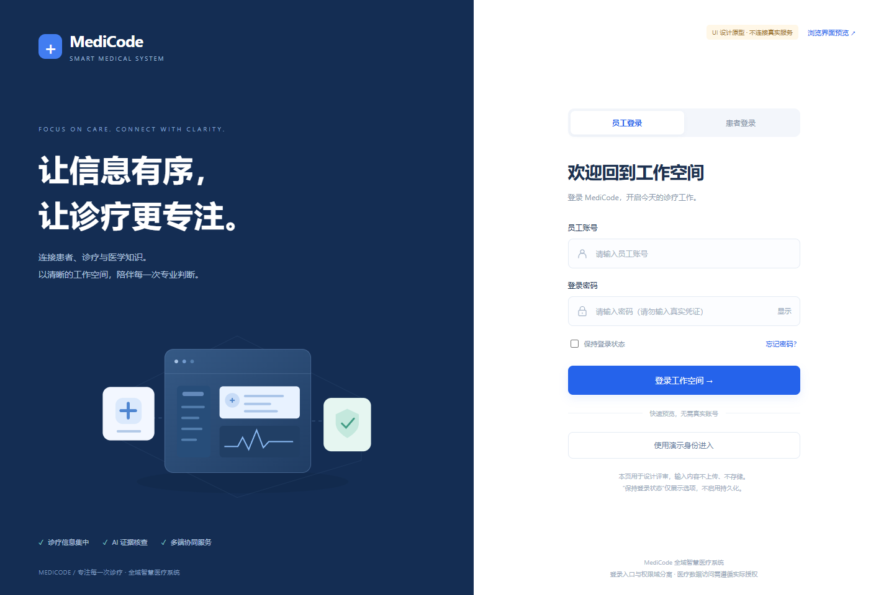
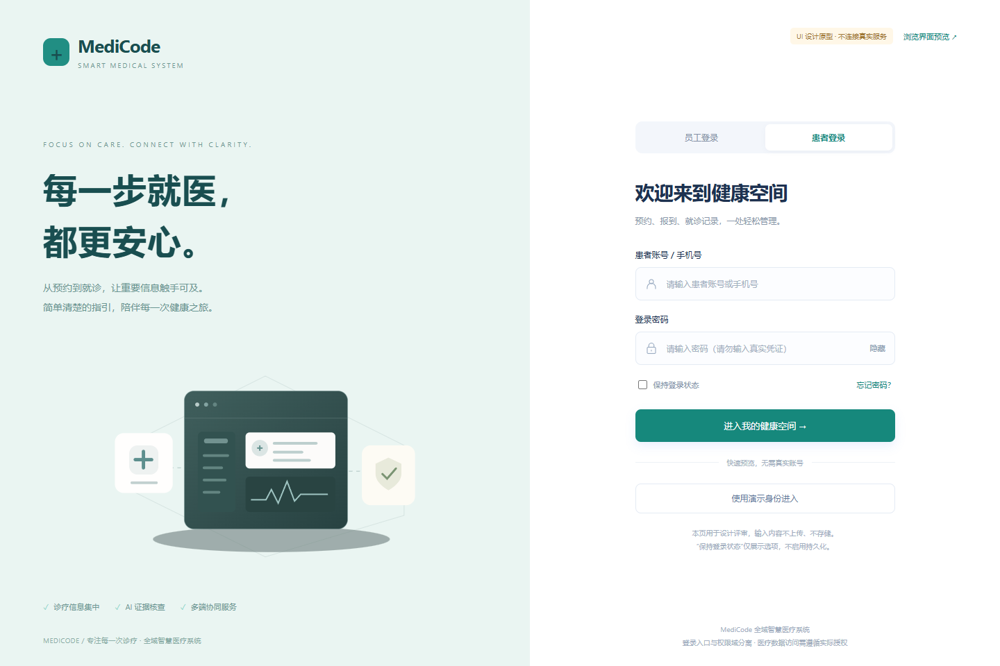
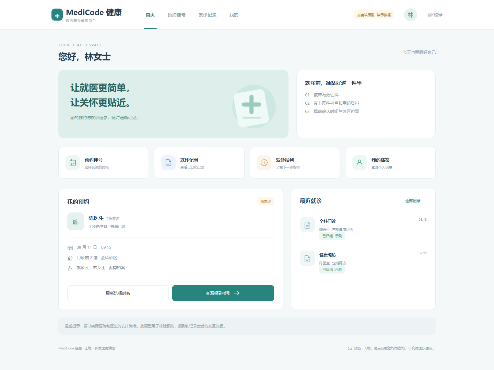
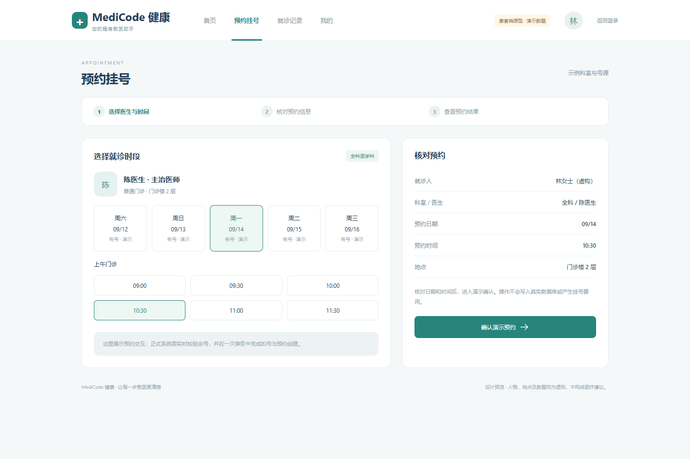
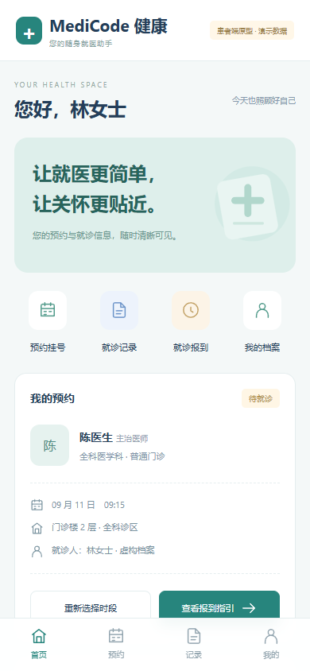

# MediCode 系统优化方案

版本：1.0｜日期：2026-09-11｜范围：目录结构、UI、前端、后端、数据、部署、验证

文档性质：基于当前代码检查形成的实施建议。配套 UI 为可交互设计原型，全部人物、统计和临床内容均为虚构示例。本文中的目标结构、接口、技术选型和性能指标属于拟议方案，不代表已经实现或完成压测。

## 01 执行摘要与当前基线

MediCode 已有患者管理、诊疗记录、AI 辅助、预约排班、员工管理、知识库、低代码和插件管理等功能。优化方向是把现有功能组织为统一、可靠、易维护的产品。建议按“先修复基线与关键业务，再整理工程和服务边界，随后统一 UI，最后完成部署与验收”的顺序推进。

本次已检查项目目录、前后端入口、主要路由、认证依赖、数据库会话、患者与就诊服务、预约与排班、控制台、主题、启动脚本和 Docker 配置，并运行前端 TypeScript 检查。尚未对真实业务执行写操作，未进行全系统渗透测试、数据库迁移或性能压测。

当前技术栈以仓库依赖为准：前端为 React 19、TypeScript、Vite、Ant Design 6；后端为 FastAPI、SQLAlchemy 2、Pydantic 2；实际数据引擎为患者域和员工域两个 SQLite 数据库；MongoDB、FAISS 和云端模型为相关能力依赖。现有文档中的 React 18、Ant Design 5 等描述应同步更新。后端确切运行版本需在后续 doctor 报告中确认。

### 1.1 本轮优化目标

- 可构建：员工端与患者端均通过类型检查、构建及必要回归验证。
- 数据可靠：预约扣号、就诊生成、审计记录和权限判断具备明确的一致性规则。
- 体验连贯：从查找患者到接诊、AI 核查、医生确认、查看记录，减少无意义跳转。
- 结构清楚：业务模块、公共能力、运行数据、部署资源、工具和文档各归其位。
- 可运维：配置可解释、启动可诊断、健康状态真实、数据可恢复。

### 1.2 实施约束

- 当前工作区存在大量未提交修改和文件移动，应先记录现状并保存可恢复副本。
- 保留 frontend/、backend/ 和现有启动入口；迁移分批进行。
- 第一阶段保持 backend/data/ 中的数据文件位置不变，防止路径变化造成误读空库。
- AI 防幻觉、证据分级、引用核查、低温参数、撤回兜底及医生确认门控必须保留。
- 原型只展示设计和交互，不连接真实 API，不保存真实患者数据。
- 运行测量使用隔离数据库和明确的测试数据，指标需在约定环境中验证。

## 02 问题清单与优先级

P0：阻断构建、身份边界或核心数据一致性问题。P1：显著影响业务体验、统计可信度、部署和维护的问题。P2：模块化、视觉一致性和长期演进改进。

| 编号 | 优先级 | 发现与证据 | 影响及建议 |
| --- | --- | --- | --- |
| B01 | P0 | TypeScript 检查出现 30 余条错误，涉及缺失变量、未导入组件、无效组件属性和类型不匹配 | 正式构建被阻断。先清理类型错误，建立构建基线 |
| B02 | P0 | 员工认证依赖未明确拒绝 type=patient 令牌；两类令牌使用同一签名入口 | 身份域存在缺口。明确 token type/audience，并回归跨域拒绝 |
| B03 | P0 | 按手机号查询预约和预约报到接口未要求登录 | 缺少身份与数据归属验证。改为本人会话或受控核验流程 |
| B04 | P0 | 就诊记录服务在患者会话中写入归属员工库的 AuditLog | 可能记录已保存但接口随后失败。修正会话、跨库事件及失败语义 |
| B05 | P0 | 创建患者、扣号、创建预约分别 commit；扣号采用先读后写 | 可能扣号后无预约，并发时余量不一致。采用单事务、条件更新、幂等 |
| B06 | P1 | 控制台分别读取少量近期记录和最多 100 条记录做统计 | 样本与总量混用。改用权限范围内的后端聚合统计 |
| B07 | P1 | 顶部搜索仅跳转页面并提示搜索成功 | 交互没有真实查询效果。对接检索或明确改成功能导航搜索 |
| B08 | P1 | 共用客户端自动附加员工令牌，401 统一清理员工状态 | 复用来源和请求入口时身份可能混淆。拆分三类客户端 |
| B09 | P1 | Compose 指定 PostgreSQL，但数据库模块实际固定创建双 SQLite | 部署配置与行为不一致。显式双库 URL，并验证可选 PostgreSQL 模式 |
| B10 | P1 | 端口工具以正则改写源码，部分批处理按 ASCII 读写 | 中文、端口和 CORS 易不一致。集中本地配置，脚本只读配置 |
| B11 | P1 | /api/health 固定返回 healthy | 不能反映数据库和就绪状态。增加 live/ready 分层检查 |
| B12 | P1 | MongoDB 初始化内部吞掉连接失败，调用侧随后可能显示已连接 | 状态输出误导。返回明确结果，设置超时，快速降级 |
| B13 | P1 | 患者列表逐项计算 len(p.records) | 可能出现 N+1 查询并加载无关记录。改为聚合计数 |
| B14 | P1 | 患者库为跨库引用整体关闭外键校验 | 同库约束也被削弱。分离跨库逻辑引用并恢复同库外键 |
| B15 | P2 | 大页面、内联样式、重复 loading/error 逻辑较多 | 按业务拆分，建立设计令牌、通用组件和数据请求约定 |

类型错误已通过工具确认；其他问题来自代码检查，需要通过隔离集成测试确认具体触发条件。以上是本轮检查的发现清单，不代表对全系统所有接口的完整审计。

### 2.1 首批处理文件

| 范围 | 仓库内文件 | 改造重点 |
| --- | --- | --- |
| 构建 | frontend/src/pages/LowCodeStudio.tsx；SettingsCenter.tsx；AIAssistant.tsx；blocks/registry.tsx | 缺失变量、组件导入、类型和 API 适配 |
| 认证 | frontend/src/api/client.ts；patientAuth.ts；backend/app/core/dependencies.py | 身份域隔离、401/403、合法令牌声明 |
| 数据 | backend/app/core/database.py；services/record.py；api/records.py | 会话归属、审计、医生查询、外键 |
| 预约 | backend/app/services/appointment.py；schedule_service.py；api/appointment.py | 原子扣号、幂等、归属、取消和完成状态 |
| UI | frontend/src/layouts/MainLayout.tsx；pages/Dashboard.tsx；index.css；theme.ts | 导航、真实统计、共享样式、响应式 |
| 运维 | Port/select_free_port.ps1；bat/；docker-compose*.yml | 配置集中、路径兼容、真实健康检查 |

## 03 目标目录结构与迁移方式

保留根目录的 frontend/ 与 backend/，内部按业务组织，脚本与部署资源单独归档。目标结构是渐进迁移的终态，不要求一次创建所有层级。

```text
MediCode/
├── README.md                     # 项目与快速启动入口
├── CLAUDE.md                     # Agent 桥接文档
├── .gitignore
├── .editorconfig
├── .env.example                  # 不含真实密钥
├── frontend/
│   ├── package.json
│   ├── package-lock.json
│   ├── vite.config.ts            # 员工入口保持兼容
│   ├── vite.patient.config.ts    # 患者入口保持兼容
│   ├── config/vite.shared.ts
│   ├── patient/                  # 患者 HTML 与启动入口
│   ├── src/
│   │   ├── app/
│   │   │   ├── staff/            # 路由、Provider、布局
│   │   │   └── patient/
│   │   ├── features/
│   │   │   ├── auth/
│   │   │   ├── patients/
│   │   │   ├── appointments/
│   │   │   ├── medical-records/
│   │   │   ├── doctor-workbench/
│   │   │   ├── ai-assistant/
│   │   │   ├── knowledge/
│   │   │   ├── staff/
│   │   │   └── administration/
│   │   ├── platform/lowcode/     # Schema、区块、动态页面
│   │   └── shared/
│   │       ├── api/
│   │       ├── ui/
│   │       ├── hooks/
│   │       ├── lib/
│   │       ├── styles/
│   │       └── types/
│   └── tests/e2e/
├── backend/
│   ├── app/
│   │   ├── main.py               # 启动入口保持兼容
│   │   ├── application.py        # 应用创建与生命周期
│   │   ├── core/                 # 配置、认证、异常、日志
│   │   ├── infrastructure/
│   │   │   ├── database/
│   │   │   ├── storage/
│   │   │   ├── vector/
│   │   │   └── llm/
│   │   ├── modules/
│   │   │   ├── identity/
│   │   │   ├── patients/
│   │   │   ├── appointments/
│   │   │   ├── medical_records/
│   │   │   ├── knowledge/
│   │   │   ├── ai/
│   │   │   ├── staff/
│   │   │   └── audit/
│   │   └── platform/
│   │       ├── plugins/
│   │       └── lowcode/
│   ├── migrations/
│   ├── tests/
│   ├── data/                     # 保留数据位置，禁止提交
│   ├── pyproject.toml
│   ├── requirements.txt
│   └── .env.example
├── config/
│   ├── agent_config.json
│   └── development.example.json
├── scripts/
│   ├── dev/                      # 启动、停止、status、doctor
│   ├── database/                 # 初始化、备份、恢复
│   └── maintenance/              # 独立维护工具
├── bat/                          # 保留中文双击入口
├── deploy/nginx/
├── db/                           # 历史 SQL 参考
├── docs/
│   ├── 使用文档/
│   ├── 开发文档/
│   └── 设计预览/
├── docker-compose.yml
└── docker-compose.dev.yml
```

### 3.1 目录迁移映射

| 当前位置 | 建议归属 | 兼容安排 |
| --- | --- | --- |
| frontend/src/pages、api、stores 中业务文件 | features/对应业务 | 逐页迁移，旧导出短期转发，更新路由 |
| frontend/src/layouts 与 App 路由 | app/staff、app/patient | 保留应用入口，先提取内部实现 |
| frontend/src/blocks、dyn 通用能力 | platform/lowcode | 保留区块注册协议 |
| frontend/src/theme.ts、index.css | shared/styles | 通过原文件引入，避免一次修改全部页面 |
| backend/app/api、services、models、schemas | modules/对应业务 | 先迁低耦合模块；模型注册与插件路由同步调整 |
| Port/select_free_port.ps1 | scripts/dev | 旧入口转发；切换配置后回归一键启动 |
| init_databases.py | scripts/database | 根入口短期调用新实现 |
| 根目录独立插件安装工具 | scripts/maintenance | 检查既有调用路径后迁移，保留必要转发 |
| plugin_install_log.txt 等日志 | 忽略的运行日志目录 | 不与源码混合，不自动删除历史记录 |

### 3.2 模块内部组织

前端业务模块按实际复杂度使用 pages/、components/、api.ts、queries.ts、types.ts、validation.ts。共享 UI 放在 shared/ui，业务专用组件留在模块内部，防止公共目录演变成无边界的杂物目录。

后端模块可采用 router.py、schemas.py、service.py、models.py；复杂查询再增加 repository.py。路由不直接承载大量业务状态变更，服务不依赖 HTTP 请求对象，基础设施不反向依赖页面或路由。

新增依赖遵循单向关系：app 组合 features/modules；业务依赖 shared/core/infrastructure；共享层不导入具体页面。跨业务协作用有明确名称的服务接口完成。

### 3.3 文件和数据保护

恢复 .gitignore，至少排除 .env、数据库及其 WAL/SHM 文件、上传附件、缓存、日志、构建产物、node_modules、虚拟环境和本地端口配置。配置示例文件允许提交。运行数据归属以文档和统一路径解析器为准。

数据库初始化、结构升级、演示数据播种必须区分。db/ 中 SQL 暂作历史参考，新变更以版本迁移为准，避免 ORM、SQL 和自动补列三套结构定义分别变化。

## 04 UI 设计系统与导航规范

沿用现有 React 和 Ant Design 基础，采用清晰、克制、适合长时间工作的医疗界面。系统主要使用蓝白与浅灰蓝，辅助状态用青绿和暖金，不依靠高饱和颜色区分所有信息。

### 4.1 基础视觉令牌

| 类型 | 建议值 | 应用规则 |
| --- | --- | --- |
| 主色 | #2563EB | 主按钮、当前导航、关键链接 |
| 深色强调 | #142D53 | 控制台欢迎区和少量重点信息 |
| 辅助青绿 | #138D85 | 完成、积极状态和辅助图表 |
| 暖金 | #D6A451 | 关注事项；同时提供文字状态 |
| 页面背景 | #F4F7FB | 布局底色 |
| 内容表面 | #FFFFFF | 卡片、表单与表格 |
| 主文字 | #1B2B45 | 标题和正文 |
| 间距 | 4/8/12/16/24/32px | 统一布局节奏 |
| 圆角 | 控件约 8px；主卡片 12–14px | 避免页面各自指定 |
| 字号 | 页面标题 24–26px；正文 14px；辅助 12–13px | 正式实现需验证对比度和缩放 |
| 密度 | 舒适/紧凑 | 员工表格可切换，不压缩核心触控目标 |

令牌统一在 Ant Design 主题和 CSS 变量中管理。深色文本、背景、边框、状态色都应有语义名称。逐步替换内联颜色，保留现有公共样式过渡层。

### 4.2 员工端框架

- 桌面侧栏约 232px，折叠后约 72px；小屏改为抽屉。
- 顶部栏固定，放当前位置、功能搜索、通知、身份与角色。
- 主内容包含页面标题、简短说明、一个明确主操作、筛选区和业务内容。
- 导航分为工作台、诊疗服务、知识与 AI、员工协作、系统管理。
- 角色决定默认首页和可见菜单，真实授权仍由后端执行。
- 当前路由所属菜单自动展开，高亮与面包屑一致。
- 移除仅显示演示消息的占位按钮，真实实现前应明确标注功能状态。
- 通知已读后同步数量；失败时反馈，不产生静默成功假象。
- 图标按钮提供名称和焦点；表格在局部容器滚动，禁止撑破整个页面。

### 4.3 通用页面状态

每个请求页面至少设计加载、成功、空数据、失败、无权限五类状态。加载用与最终结构相近的骨架；空数据说明原因和下一步；失败保留已输入内容并允许重试；权限不足不清空用户身份。

长表单支持分组与定位，主要操作保持容易找到。涉及不可逆或重要状态变化的操作应清晰说明后果，普通查看和筛选保持直接。所有提示避免只依靠颜色表达。

### 4.4 响应式与可访问性

以 1440、1024、768、390px 作为主要验证宽度。员工端在窄屏保持核心信息可读；患者端移动优先。主要触控操作目标建议不少于 44px；支持键盘导航、可见焦点、合理标签、200% 缩放及减少动态效果设置。

原型展示视觉方向；正式实现时需针对实际字号、状态颜色、长文案和真实数据做对比度及布局验证。

## 05 核心页面与业务体验

### 5.1 控制台

控制台按角色展示：医生关注接诊、草稿和 AI 确认；管理员关注业务待办和运行状态。系统状态只能来自真实健康检查，不能因页面渲染成功就宣称正常。

统计口径统一为：明确时间范围、明确权限范围、明确事件字段。例如本月就诊数使用约定时区和就诊日期；AI 辅助记录数仅计入包含实际建议的记录。不得将最近 5 条或 100 条样本推算为全局统计。

- 后端提供聚合统计接口，返回统计范围、时间区间和更新时间。
- 趋势使用完整日期排序，补齐零值日期，处理跨月跨年边界。
- 待确认仅计入确实需要审核的 AI 建议。
- 指标点击后进入含对应筛选条件的列表。
- 请求失败显示失败和重试，不能自动显示零值。
- 最近患者、最近就诊与待办独立加载，局部失败不阻断整页。

### 5.2 患者列表与详情

列表支持姓名、档案编号和许可范围内的联系方式检索；搜索防抖、分页与过滤规则一致。可配置列和密度，主要操作是查看档案、进入接诊、新建患者。年龄计算应考虑生日，不能只减年份。

详情顶部汇总身份、联系方式和过敏提醒；正文组织就诊时间线、病史、报告和预约。重要字段缺失要明确展示，不用无依据的默认值代替。删除与归档的业务语义需要独立确定，避免误删历史诊疗链路。

### 5.3 医生工作台

桌面采用三栏：左侧接诊队列，中间病历编辑，右侧既往资料与 AI 辅助。窄屏将辅助区变成抽屉或标签页，避免正文被挤压。

主要流程：选择患者 → 核查身份与过敏史 → 补充主诉和病史 → 查看辅助结果与证据 → 医生填写诊断和处置 → 保存或完成接诊。

草稿保存到后端并带版本号。离开未保存页面时说明未保存状态；并发修改使用版本冲突提示；网络异常保留编辑内容。接诊完成与病历生成要有幂等规则，重复点击不能重复生成记录。

### 5.4 就诊记录与审核

记录列表展示患者、接诊医生、就诊时间、诊疗摘要、AI 审核和管理审核状态。详情附审核轨迹与必要的版本历史，明确操作者和时间。被驳回的记录展示原因及可执行下一步。所有列表、详情、动态集合和导出遵循同一数据范围。

### 5.5 AI 辅助诊疗

保留现有规则引擎、相似病例、知识检索和可选云端模型能力。界面区分来源、处理阶段、证据和最终医生确认。

- 分析过程展示规则分析、病例检索、知识检索、引用核查等阶段。
- 结果附证据来源、文档版本、引用片段和定位信息。
- 证据不足、引用失效、模型不可用应作为明确状态展示。
- 相似度、规则分数、模型置信信息分别命名，不统一宣称诊断准确率。
- 医生可编辑、采纳、驳回；保存原始建议、修改内容、操作者和确认时间。
- 不因接入云端模型而绕过既有防幻觉验证与医生确认。
- 敏感信息外发采用明确配置、最小必要字段和可审计记录。

### 5.6 知识库与设置中心

知识库以检索和来源核查为中心，展示分类、来源、版本、审核状态与更新时间。原文预览和引用定位相邻，减少核查成本。

设置分为个人设置、组织管理、系统配置。当前较大的 Settings 页面应按职责拆分，普通用户不显示管理员配置项；后端继续独立校验。

### 5.7 患者移动端

主导航控制在首页、预约、就诊记录、我的。首页优先展示当前预约和下一步操作。预约卡片必须明确医生、日期、时段、地点、状态和报到入口。

预约选择流程：科室/医生 → 日期与真实余号 → 就诊人 → 核对 → 提交 → 结果。提交期间防止重复操作，失败解释是否扣号。患者查询、修改和报到均需要归属验证。个人资料与账号安全分组，避免把复杂后台配置带入患者端。

## 06 前端服务与工程改造

### 6.1 三类 HTTP 客户端

| 客户端 | 令牌范围 | 失败与失效行为 |
| --- | --- | --- |
| staffClient | 仅员工令牌 | 401 清理员工会话并跳转员工登录；403 保留登录 |
| patientClient | 仅患者令牌 | 401 清理患者会话并跳转患者登录，不影响员工态 |
| publicClient | 默认不附加身份 | 登录失败和公开查询错误由对应页面处理 |

拦截器不覆盖调用方合法的显式认证头。登录接口的 401 展示凭证错误；请求取消不报失败；网络、服务器、校验和权限错误分别处理。登录返回地址限制为站内路径。身份切换清理相关缓存，防止展示上一位用户的信息。

### 6.2 服务端状态管理

建议逐步引入 TanStack Query，从患者列表、控制台和预约开始。查询键包含身份、权限范围、过滤与分页；修改后仅使相关缓存失效。默认不把医疗查询缓存持久化到浏览器本地存储。UI 开关与表单状态留在组件或适当的局部状态中。

搜索采用约 300ms 防抖和过时请求取消，切换条件后回到第一页。非敏感筛选条件可同步 URL；姓名、手机号和症状等敏感检索内容避免无必要写入地址栏、日志或分析埋点。

### 6.3 构建、类型与性能

- 先修复 TypeScript 错误，添加独立 typecheck 命令。
- 患者 HTML 与 PatientApp 等独立入口纳入类型检查，避免只检查 src/。
- 基于当前 React 19 与 Ant Design 6 的类型定义修复属性和导入，不随意降级依赖。
- 页面按业务懒加载，使用局部 Suspense 与错误边界，导航框架保持稳定。
- 实测构建产物后再拆分过大依赖，避免盲目手动切包。
- 维护 lockfile，采用可复现安装；员工和患者构建输出分别定义。
- API 类型可逐步从 OpenAPI 生成，先规范重要接口，再扩大生成范围。

### 6.4 共享组件清单

建议优先形成 PageHeader、FilterBar、DataTableShell、StatusBadge、EmptyState、ErrorState、PatientSummary、EvidenceCard、AuditTimeline 等组件。组件表达稳定的交互与视觉规则，业务判断留在所属模块，避免通用表格组件塞入所有诊疗逻辑。

## 07 后端服务与身份边界

采用模块化单体：一个 FastAPI 部署单元，内部以身份、患者、预约、病历、知识、AI、员工和审计划分模块。这与当前本地和边缘设备场景相匹配。

请求链路：路由 → 参数校验与身份解析 → 业务服务和权限判断 → 数据与外部依赖 → 明确事务提交 → 响应。服务负责业务规则，不由前端是否显示按钮来决定授权。

### 7.1 身份与权限

令牌明确员工/患者身份域，规范 sub、aud、iss、exp 等字段；验证缺失或非法 ID；员工入口必须拒绝患者令牌。旧令牌兼容或强制重新登录应作为一次明确的发布行为，不能长期维持模糊语义。

权限包含三层：身份有效、功能允许、数据可见。角色与组织关系决定数据范围；普通接口、动态集合、导出与审核操作共享规则。/api/system/routes 这类声称管理员专用的接口也应实际使用管理员权限依赖。

### 7.2 API 契约

重要请求由 Pydantic 模型定义：预约、排班修改、个人资料、病历审核和 AI 输入输出。对范围、状态枚举、日期和长度设合理约束。统一分页字段和排序规则；非法过滤参数返回明确校验错误。

错误响应建议包含稳定 error_code、message、request_id 和字段错误；内部异常堆栈留在受控日志，不直接返回给用户。现有 /api 路径先兼容，破坏性变化再规划版本化。禁止对重要失败统一吞掉异常。

### 7.3 查询与阻塞任务

患者列表计数改为聚合或合适预加载。控制台由 SQL 聚合返回结果，跨库姓名批量取回。索引依据实际查询计划增加，避免一次给所有列建索引。大型导出使用流式或后台任务。

普通同步数据库请求可继续使用同步接口。异步接口中的阻塞数据库、计算或文件操作采用明确的线程或任务执行方式。云端模型请求设超时与取消策略；训练、向量重建和批量导入返回任务 ID，支持进度、失败原因及重试。

### 7.4 应用生命周期与插件

应用创建与启动副作用分离，便于测试。插件注册和路由挂载应避免多次生命周期导致重复路由。插件管理区分配置状态与实际生效状态，重启生效的变更明确提示重启。

可选服务初始化返回明确结果。MongoDB 不可用时按配置快速降级，日志与状态页一致；关闭时释放已经创建的连接。诊断、索引和知识依赖的降级状态应影响相关功能提示。

## 08 数据一致性、迁移与低代码

### 8.1 双库边界

显式区分 get_patient_db 和 get_employee_db。患者库保存患者、预约、诊疗与相关患者域数据；员工库保存用户、员工消息、通知、审计和平台管理信息，最终归属以模型清单为准。

跨域读取调用明确服务，不把患者会话用于查询员工 User 或写 AuditLog。跨库逻辑引用在应用层验证，同库关系由数据库执行外键。恢复患者库外键前先检查孤立数据与历史兼容情况。

### 8.2 预约原子性与幂等

一次预约事务完成身份与号源校验、原子占用号源、预约写入和幂等记录，一次提交。以条件更新验证 booked < total 及开放状态，检查实际更新行数。失败统一回滚，返回清晰业务错误。

创建预约由唯一幂等键约束，同一请求重复提交返回原结果。取消只释放一次号源；号满、停诊、取消、完成的允许转换用状态规则表达。完成就诊只生成一份关联病历，可增加预约与病历的唯一关联约束。

### 8.3 跨库审计事件

普通事务不能保证两个独立库原子提交。建议先修复明显会话错误，再增加患者域持久化事件表：业务记录和待发送事件同事务提交，后台处理器投递到员工审计库，唯一事件 ID 防重复。

事件有待处理、成功、重试和失败状态；记录最后错误和重试时间；保留可查询的投递积压指标。第一阶段可以由应用内处理器执行，无需立即引入外部消息中间件。

### 8.4 数据库配置与迁移

开发模式保留双 SQLite，分别配置 PATIENT_DATABASE_URL、EMPLOYEE_DATABASE_URL。默认路径相对后端目录解析，不依赖当前终端工作目录。评估 WAL、合理 busy timeout 和连接生命周期。

生产 PostgreSQL 模式必须连同驱动、双库策略、迁移及低代码动态 SQL 一起验证。未验证前不得把 Compose 声明当作已经支持生产数据库的证据。

采用 Alembic 维护结构版本；初始化、演示播种、升级分别执行。迁移前备份，核对行数和必要约束。破坏性变化优先采用新增字段、双读兼容、迁移历史数据、切换读取、最后清理的步骤。无法安全逆向迁移时，提供经过验证的备份恢复方法。

### 8.5 低代码边界与发布

公告、请假、组织和一般办公数据适合动态集合。病历确认、处方与扣号等操作调用领域服务，限制动态引擎直接修改核心表。系统集合、普通 API 和导出使用一致权限规则。

页面发布采用草稿 → Schema 校验 → 角色预览 → 发布版本 → 保留回滚。Schema 包含版本、允许区块、字段与权限声明；非法区块或配置应有可解释错误。发布记录操作者、时间和差异，避免直接覆盖导致无法追踪。

## 09 启动、部署与运行诊断

### 9.1 集中配置与启动器

后端、员工端、患者端端口集中在项目级本地开发配置，提供可提交的 example。环境变量可覆盖默认值，配置优先级写入文档。端口工具仅更新本地配置，不再正则修改源码、CORS 字符串或中文脚本。

启动顺序：定位项目 → 检查运行时与依赖 → 优先项目虚拟环境 → 校验配置与可写目录 → 检查端口 → 启动后端并等待 ready → 启动两端 → 输出地址和日志。失败展示错误与修复方式，不能仅提示三个窗口已经启动。

记录本次启动进程 ID 和所属项目。停止命令只处理这些进程，不按宽泛进程名或端口清理其他程序。保留 bat/ 四个中文入口，复杂实现转交 scripts/。

### 9.2 doctor 命令

| 检查范围 | 应输出内容 |
| --- | --- |
| 运行时 | Python、Node、npm 版本与实际路径，项目虚拟环境状态 |
| 依赖 | 后端关键模块、前端依赖及 lockfile 状态 |
| 构建 | 员工与患者类型检查结果、明确错误位置 |
| 端口 | 三个配置端口、是否可绑定、占用信息 |
| 数据 | 两个数据库路径、连接结果、迁移版本 |
| 配置 | 缺失项名称和示例位置，禁止输出密钥值 |
| 依赖服务 | MongoDB、向量、模型的启用与可用状态 |
| 进程 | live、ready、日志位置、项目进程记录 |

### 9.3 Docker 与 Nginx

- 增加 .dockerignore，排除真实 .env、数据库、上传文件、日志、缓存和本机依赖。
- 默认 Compose 对齐真实双库模式，PostgreSQL 作为经过验证后的可选模式。
- 补齐患者端独立构建和访问入口，员工与患者资产不相互覆盖。
- 挂载 agent_config.json 和必要运行数据，验证容器内路径解析。
- 为后端增加健康检查，前端代理以服务 ready 为依据。
- 固定经过验证的运行时与依赖版本，避免镜像更新引发不可复现问题。
- 生产关闭 DEBUG；演示账号创建使用显式开发开关，生产初始化使用独立凭证流程。
- Nginx 配置 SPA 回退、静态资源缓存、上传大小及 API 超时，并与后端限制一致。

### 9.4 健康、日志和备份

live 只表示进程可响应；ready 验证双库连接与必要配置；详细状态需要管理权限，包含插件、模型、向量和可选 MongoDB。可选服务失败不应令整个核心系统退出，但相关功能需准确标记降级。

日志包含请求 ID、动作、耗时和必要错误码，避免记录完整病历、令牌、密钥和敏感检索内容。保留日志轮转与容量上限。部署文档明确备份频率、保留策略、加密或访问控制、恢复负责人及恢复验证步骤。

## 10 测试与验收标准

以下指标为拟定目标，需约定机器、数据集、并发模型、业务时区和测试命令。不得把设计目标写成已经取得的性能结果。

| 类别 | 验收用例 | 通过标准 |
| --- | --- | --- |
| 构建 | 两端类型检查和生产构建 | 全部成功，无缺失变量或不匹配组件属性 |
| 身份 | 患者 token 请求员工接口；反向请求 | 都被明确拒绝，正常同域请求可用 |
| 权限 | 本人、同科室、上级、管理员、无关人员访问同一数据 | 结果符合已定义矩阵，动态集合与导出一致 |
| 预约归属 | 按手机号查询、报到、取消 | 需要合法身份与归属校验 |
| 并发 | 10 个号源、50 个并发预约请求 | 成功数不超过 10，余量与预约数量一致 |
| 幂等 | 重复提交预约、取消、完成 | 不重复扣号、释放或生成病历 |
| 事务 | 扣号后模拟预约写入失败 | 全部回滚，没有孤立占号 |
| 审计 | 员工库不可用后恢复 | 已提交事件可追踪并重试，无重复日志 |
| 统计 | 200 条以上记录、跨月跨年、无记录日期 | 与 SQL 基准一致，时间排序与零值正确 |
| 前端请求 | 快速搜索、切换身份、取消请求 | 无旧结果覆盖，无跨用户缓存泄露 |
| UI | 1440/1024/768/390px、键盘、长文案 | 核心操作可达，页面无非预期横向溢出 |
| 页面状态 | 请求失败、空数据、403 | 均有正确反馈和下一步，不伪装成功 |
| 性能 | 约定本机环境下 1 万条患者数据 | 列表接口 P95 < 500ms 作为初始目标 |
| 启动 | 可选 MongoDB 不可用 | 核心服务在限定超时内 ready，准确报告降级 |
| 数据恢复 | 隔离目录完成备份恢复 | 结构版本、行数及关键关联核对通过 |

### 10.1 测试分层

后端优先单元和集成测试认证、事务、状态机、跨库归属和迁移；前端测试客户端隔离、查询竞争和关键表单；端到端覆盖患者预约、医生接诊、AI 确认、管理员配置。纯视觉调整采用构建检查、截图和人工视觉验证，不为简单样式创建机械重复测试。

CI 最小检查链路为可复现安装、前端 typecheck 与 build、后端关键测试、必要端到端检查。数据库测试使用临时库或专用实例，禁止指向实际 backend/data/。

## 11 实施阶段、交付与回退

| 阶段 | 内容 | 交付物 | 退出条件 |
| --- | --- | --- | --- |
| A 修复基线 | 类型错误、身份域、预约归属、跨库写入、事务 | 错误清单、关键修复、回归用例 | 两端构建及 P0 用例通过 |
| B 整理工程 | 目录迁移、HTTP 客户端、配置、脚本 | 迁移映射、兼容入口、启动器 | 原有入口可用，数据路径正确 |
| C 统一 UI | 主题、布局、导航、控制台、患者、工作台、患者端 | 共享组件、核心页面与状态 | 多尺寸验证通过，主要流程连贯 |
| D 完善服务 | 聚合、查询优化、迁移、事件、后台任务 | 明确 API、任务与数据一致性机制 | 聚合和事务目标通过验证 |
| E 部署验收 | Docker、doctor、健康、日志、备份、文档 | 可复现部署包、检查报告 | 干净环境完成业务闭环与恢复验证 |

### 11.1 建议实施批次

每批只包含可解释的改变。目录移动与业务修复尽可能分开，视觉调整与接口契约调整分开，便于审阅和回退。优先完成构建、登录、患者查询、预约、病历保存，再接入新的页面布局。

各阶段完成后记录新增能力、兼容变化、验证命令、已知限制和恢复步骤。具体人日应在首轮修复与测试基线明确后估算，避免把初步排期作为承诺。

### 11.2 回退安排

- 源码：每批保存明确变更范围，不覆盖已有未提交工作。
- 路由：迁移期保留旧入口和必要转发，避免书签失效。
- 配置：本地配置变更前保留上一版本，不保存密钥到文档。
- 数据：结构变化前备份；迁移失败停止继续写入，按已验证流程恢复。
- UI：新布局按页面替换，关键业务仍可通过已验证路由进入。
- 插件与低代码：保存发布版本，支持回到上一已知可用配置。

## 12 配套 UI 原型与交付说明

本次原型位于 docs/设计预览/index.html，可独立在现代浏览器打开，不依赖 npm 安装或在线字体。它展示控制台、患者管理、医生工作台和患者移动端四个主要场景。

可演示交互：导航切换、就诊趋势周/月切换、患者检索和重置、切换接诊对象、草稿提示、AI 示例显示、证据说明、患者预约时段选择、报到状态示例、舒适/紧凑密度与移动抽屉。

原型中的保存、接诊和预约仅更新演示 UI 或提示，不表示系统已经具备对应后端能力。部分菜单以说明弹窗或相邻场景展示设计意图，正式实施应使用实际业务页面。原型的统计值、患者名称和就诊内容全部为虚构样例。

以下图片为配套原型实际渲染截图。









### 12.1 原型到正式系统的衔接

评审时先确认信息层级、导航分组、医生三栏布局和患者预约路径，再将视觉令牌及组件迁入现有 React 工程。正式页面的数据、权限、表单验证与状态转换接入前述服务方案。原型 HTML 不直接替换生产应用。

### 12.2 交付清单

- MediCode系统优化方案.docx：排版后的完整方案，包含表格、目录结构和 UI 截图。
- MediCode系统优化方案.md：便于后续维护和生成文档的内容源文件。
- docs/设计预览/index.html：可交互离线原型。
- docs/设计预览/01 至 06 图片：桌面与窄屏实际渲染效果。
- tools/ 中的生成与验证脚本：用于复现文档和原型截图。

## 13 登录与完整患者端补充设计

本节根据补充要求增加员工登录、患者登录和独立患者端页面。配套 login.html 支持两种身份切换；patient.html 提供首页、预约、就诊记录、我的四个独立页面，可在桌面或手机宽度使用。原有 index.html 继续提供员工系统及手机外观展示。

### 13.1 员工登录

桌面采用双栏，左侧为品牌、产品价值和医疗信息协作插画，右侧为身份切换、账号、密码、忘记密码、登录与演示入口。移动端缩小品牌区，登录表单位于主要可见区域。

正式实现必须包含空字段提示、错误凭证提示、提交中禁用、请求超时、重试和返回目标路由。显示/隐藏密码应有可读按钮名称。保持登录选项只有在认证方案支持相应生命周期时才能实际生效；不能仅保存完整用户与长期令牌就宣称安全持久登录。

员工注册、密码重置和账号激活沿用确认后的组织管理策略。默认不开放任意员工自行注册为管理员。演示模式开关与正式认证隔离，生产部署不展示虚构登录成功。

### 13.2 患者登录

沿用相同品牌，但使用更温和的青绿主题与“我的健康空间”文案。登录字段匹配当前患者认证能力：账号或手机号与密码。验证码登录仅在短信验证服务和后端验证流程真正具备后开放，不保留可用于真实身份认证的演示验证码。

患者登录成功进入本人首页；401 只清理患者会话；忘记密码进入本人核验流程。患者与员工入口相互切换不应串用状态。独立前端域名、端口和客户端均需覆盖回归。

### 13.3 患者端完整页面

| 页面 | 主要内容 | 实际接入要求 |
| --- | --- | --- |
| 首页 | 欢迎、快捷入口、最近预约、就诊记录、到院提醒 | 从本人会话读取，加载失败不展示他人缓存 |
| 预约 | 医生、日期、时段、就诊人、地点、核对确认 | 获取真实余号，确认提交采用幂等键 |
| 预约结果 | 医生、时间、地点、当前状态、报到 | 以服务端结果为准，不用客户端猜测扣号成功 |
| 报到 | 到院指引、合法状态下确认 | 验证登录与归属，重复操作幂等 |
| 就诊记录 | 已获准查看记录、详情 | 服务端过滤未发布或无权访问内容 |
| 我的 | 个人资料、就诊人、密码、帮助、退出 | 代办或家庭成员访问必须有明确授权模型 |

新增原型截图如下，所有内容均为虚构演示。











## 14 执行模型必须遵守的工作协议

本节把建议拆成可逐项完成的工单，降低执行过程中的猜测。文档不能替代实际阅读代码、运行测试与结果审阅；“完成”必须有可核验结果，不能仅因已编辑文件而宣告完成。

### 14.1 每次开始工作时

1. 确认当前目录是 MediCode 项目，读取 CLAUDE.md 与实际存在的 AGENTS.md。
2. 读取本手册对应工单，确认依赖工单已完成；未完成则先做依赖。
3. 执行 git status --short，记录已有修改，不还原或覆盖未知来源文件。
4. 用 rg 搜索现有函数、调用点、模型和接口，确认文档路径尚未过时。
5. 读取相关代码全文或完整调用链，至少识别入口、服务、模型、响应和调用页面。
6. 写明本工单要改的文件、预期行为和验证方法，再进行小范围修改。

### 14.2 固定执行循环

先复现 → 补充能够捕获问题的关键测试 → 最小修改 → 运行该工单验证 → 检查差异 → 更新进度记录。视觉和目录等低影响任务不强制写机械测试，可用构建、路径检查与截图代替。

同一轮只处理一个工单或一组明确相关的子项。不要同时移动大量文件、改鉴权、换组件库和重写数据库。必须保持每一步都有可运行的检查入口。

### 14.3 禁止采用的完成方式

- 不得通过关闭 TypeScript 校验、删除关键校验、滥用 any 或 @ts-ignore 让构建“通过”。
- 不得删除既有功能、路由或数据库表来回避复杂问题。
- 不得把接口错误吞掉并返回空数组、零值或假成功。
- 不得用前端隐藏菜单代替后端权限校验。
- 不得关闭整个数据库外键来规避跨库关系。
- 不得把原型假数据、示例密码或演示验证码接入生产流程。
- 不得把单次正常请求通过当作并发、失败回滚与幂等都已验证。
- 不得修改真实患者数据做测试；不得直接删除现有数据目录。
- 不得擅自升级所有依赖、迁往微服务或引入未在本批次说明的新服务。

### 14.4 统一工单完成记录

```text
工单编号：
状态：未开始 / 进行中 / 已验证完成 / 受阻
改动文件：
问题复现：输入、前置状态、实际结果
最终行为：输入、状态转换、返回值
验证命令：完整命令和工作目录
验证结果：退出码、通过数量、关键截图或输出路径
兼容影响：旧入口、旧数据、旧令牌如何处理
已知限制：尚未验证的环境或场景
下一工单：
```

只有依赖、修改、必要验证和文档更新均完成，才可以标记“已验证完成”。环境缺失时明确说明未验证项，不能编造成功输出。业务规则不清楚时，先沿用当前合法规则并记录待确认项，不擅自增加授权范围。

## 15 分步骤实施工单

以下“目标文件”可能在目录迁移后变化；以搜索确认的新路径为准。拟新增命令、文件和测试名称属于目标，不表示当前仓库已经存在。

### T00 保存基线与隔离测试环境

依赖：无。目标：明确真实运行环境、保留现状、避免测试污染业务数据。

读取：根目录清单、CLAUDE.md、两个 package/requirements 配置、数据库配置和所有启动入口。

步骤：记录 git 状态；记录 Python、Node 和 npm 实际版本；确认 backend/data/ 的真实解析路径；只记录数据文件名和大小，不输出数据内容；为测试创建独立临时目录；确认测试配置不会加载生产 .env 或触发真实演示播种；保存前端类型检查输出。

验证：测试连接的绝对路径不等于 backend/data/ 下任何实际业务库；现有库文件未被测试写入；基线报告包含当前构建错误和未验证项。

失败处理：如果测试无法指定独立数据库，先完成 T04 配置解耦，再继续数据库测试。

### T01 修复员工与患者端构建

依赖：T00。目标文件：frontend/src/ 下当前 TypeScript 报错文件、tsconfig.app.json、package.json 及患者入口配置。

步骤：重新运行基线命令，按实际错误修复缺失标识符和导入；例如核查 SettingsCenter 的 Popconfirm、LowCodeStudio 的 rule 作用域；按真实 API 类型修复 SimilarCase 字段；按 Ant Design 当前版本修复 Text 等组件属性；删除确实不用的变量与导入；将 patient/ 入口纳入适当 tsconfig；增加 typecheck 脚本；执行两端构建。

验收：typecheck、build、build:patient 退出码均为 0；没有通过降低类型要求掩盖问题；关键页面可以加载。若当前 build:patient 未先做类型检查，应调整脚本或 CI 让患者类型检查必经。

失败处理：不要批量给类型加 any。回到字段生产者与调用方，确认字段是缺失、命名错误还是可选，再修正契约。

### T02 明确令牌身份域

依赖：T00，数据库相关测试需 T04。目标文件：core/security.py、core/dependencies.py、services/auth.py、api/patient_account.py。

步骤：列出所有发放和解析 token 的入口；为员工与患者签发明确身份域；依赖层检查身份域和用户 ID 合法性；查找使用 optional 认证的接口并同样修正；定义旧令牌迁移策略；为不同角色、同 ID 跨域、非法 sub、过期 token、停用用户编写测试。

验收：患者 token 即使其 sub 与员工用户 ID 相同也不能进入员工身份；相反方向同样失败；合法账号正常使用；缺失或非法 sub 返回认证失败而不是 500。

禁止：仅根据请求 URL 推测身份；仅检查 token 含有 role 字段；使用 JWT 解码结果而不验证签名和声明。

### T03 修复患者预约数据归属

依赖：T02。目标文件：api/appointment.py、api/patient_account.py、services/appointment.py，以及前端 appointment API。

步骤：列出公开预约查询、报到、创建、取消接口；给本人查询和状态变更加入患者认证；从当前账户得到 patient_id，不能信任客户端提交的任意 patient_id；若保留代办或匿名预约，单独设计受控核验凭证及有效期，未实现前不得绕过归属校验；调整前端调用。

验收：患者 A 无法查询或报到患者 B 的预约；只知道手机号或预约 ID 不能访问；医生合法接诊接口继续工作；无预约与无权限的响应不会泄露多余身份信息。

### T04 解耦双库配置与测试会话

依赖：T00。目标文件：core/config.py、core/database.py、.env.example、测试 fixture。

步骤：增加明确的患者/员工连接配置；默认指向原有两个数据库；以代码文件位置解析默认目录；提供创建引擎与会话的可复用函数；测试注入临时库；保留旧 get_db 的过渡别名；验证从根目录与 backend/ 启动时默认路径一致。

验收：不配置变量时仍使用原有数据；测试使用临时库；两个 URL 可以独立覆盖；启动不因工作目录变化创建另一套库。

注意：修改配置模型时检查当前 .env 字段兼容，避免增加严格校验后被既有字段阻断；不得输出真实密钥。

### T05 修复跨库读写与患者域外键

依赖：T02、T04。目标文件：services/record.py、api/records.py、通知服务、相关模型。

步骤：搜索 AuditLog、User、Notification、Message 的所有数据库使用点；把员工域读写转到正确依赖或服务；一次批量获取医生姓名；检查 patient.records 等关系；列出跨库 ForeignKey 声明；制定迁移以移除无法执行的跨库外键，保留同库外键；在副本上检查孤立数据后启用约束。

验收：创建病历不再因为审计表不存在而失败；指定其他医生时姓名解析成功；通知进入员工库；患者库内部非法外键被拒绝。跨库投递失败的最终一致性由 T07 完成。

### T06 预约单事务、原子扣号与幂等

依赖：T03、T04。目标文件：services/appointment.py、services/schedule_service.py、预约/排班模型、迁移。

步骤：画出当前 commit 调用链；把事务提交收敛到一个业务边界；内部函数使用 flush 或返回对象，不自行 commit；使用开放状态及剩余数量条件原子更新；预约关联准确的 schedule_id；增加幂等键唯一约束；同键同请求返回同结果、同键不同请求返回冲突；取消和完成以允许状态转换为条件更新。

验收：事务中任一步失败都回滚；并发不超卖；取消不重复释放；完成不重复生成病历；并发复用同一幂等键最终只生成一单。

注意：SQLAlchemy 查询可能已自动开始事务，不能机械套一层 db.begin 导致嵌套异常。先明确事务所有者，复用或统一会话边界。不要用进程内锁替代数据库约束，因为多进程部署无法共享该锁。

### T07 持久化审计事件与重试

依赖：T05、T06。目标文件：患者域事件模型与迁移、audit 服务、后台处理器、健康状态。

步骤：为需要跨库的业务动作创建 outbox 事件；与原业务同事务写入；事件包含唯一 ID、类型、最小必要业务标识、创建时间、状态和重试元数据；投递到员工审计库，目标用 event_id 唯一约束；成功后确认事件；失败保留重试；加入并发消费和进程中断恢复策略。

验收：业务提交后进程中断不会丢事件；重复投递只生成一条审计；员工库恢复后可以重试成功；积压可查询。事件内容不包含完整病历或密钥。

### T08 统一后端错误与参数模型

依赖：T01、T02。目标文件：重要 router、schemas、异常处理器、前端错误适配。

步骤：优先定义预约创建、排班修改、病历审核和资料修改模型；约束日期、时间、状态、长度；建立稳定业务错误码；保留正确 HTTP 状态；为已有接口保留兼容字段或适配器；错误带 request_id；为字段校验和异常返回编写代表性测试。

验收：非法参数返回 4xx，不出现未经处理的 ValueError；500 不泄露堆栈和隐私；前端能显示字段错误；旧页面经过适配仍可用。

### T09 三类前端客户端与认证状态

依赖：T02、T03、T08。目标文件：src/api/client.ts、patientAuth.ts、auth.ts、stores/auth.tsx、患者 Provider。

步骤：创建 staffClient、patientClient、publicClient；逐个登记 API 所属身份域；登录/重置等公开接口使用 publicClient；患者接口仅携带患者 token；员工接口仅携带员工 token；封装身份域内退出行为；为多次同时 401 做一次性跳转保护；将 403、取消和网络错误区分；登录成功验证安全站内返回地址。

验收：同一浏览器具有两类演示会话时不会互相覆盖；错误密码不触发错误域退出；同域过期只清理同域状态；单次失败不会无限重定向。

### T10 控制台聚合统计

依赖：T04、T08、T09。目标文件：新增统计服务/路由、Dashboard.tsx、API 类型。

步骤：确定每项指标的时间字段、时区和权限范围；后端聚合患者、记录、AI 建议与待办；趋势补齐完整日期；限制可查询区间；前端分别显示加载、失败、空值；指标点击带非敏感过滤条件进入列表；移除以近期列表推算总量的代码。

验收：超过 100 条记录仍与 SQL 基准一致；跨年日期顺序正确；没有 AI 建议的记录不计入 AI 待审；失败时不显示“系统正常”或零统计。

### T11 查询优化与前端请求状态

依赖：T09、T10。目标文件：患者服务、列表查询、前端 queries、查询 Provider。

步骤：测量列表 SQL 数量和响应时间；聚合 record_count，避免每个患者加载 records；为排序与过滤增加经查询计划证明有效的索引；引入 TanStack Query 的最小用法；查询键带身份及条件；搜索防抖取消；写操作成功后失效对应缓存。

验收：分页返回字段不变；SQL 次数不随每页患者数线性增长；快速输入不会被旧响应覆盖；切换身份无旧患者数据显示；保存后列表更新。

### T12 前端目录渐进迁移

依赖：T01、T09。目标：第 03 章前端目录。步骤：先移动共享样式与客户端，再迁一个患者模块作为样板；更新导入与 tsconfig 路径别名；保留必要入口转发；搜索旧路径，区分文档示例与真实调用；对每个模块执行 typecheck 和 build；之后迁其他业务模块。

验收：每批迁移后两端均能构建；大小写在 Linux 路径环境也正确；共享层不导入具体页面；无新循环依赖；没有为迁移重写无关业务逻辑。

### T13 后端目录与应用工厂

依赖：T04、T05、T08。目标：application.py、modules/、infrastructure/、platform/。

步骤：提取应用创建与启动逻辑；确保测试可跳过生产初始化；按模块移动 router/schema/service/model；同步 SQLAlchemy 模型注册和插件注册路径；对所有已启用路由生成方法/路径清单，比较迁移前后；防止同一应用重复挂载路由。

验收：uvicorn app.main:app 原入口可用；核心路由未丢失；测试构建两次应用无重复路由；导入模块不会初始化真实数据库或尝试外部连接。

### T14 设计令牌、主布局与导航

依赖：T01、T12。目标文件：主题、全局 CSS、MainLayout、导航配置、共享组件。

步骤：提取语义颜色、间距、圆角和字号；先改主布局；将导航定义与路由权限元数据对齐；桌面侧栏与移动抽屉；页面标题与主操作统一；通知状态真实同步；搜索真正传递条件或明确改成功能搜索；补充图标按钮名称。

验收：导航高亮正确；没有只有假成功提示的搜索；小屏不横向撑破页面；Tab 可以到达核心控件；原有功能入口均可定位。

### T15 员工与患者登录页

依赖：T02、T09、T14。目标文件：Login.tsx、PatientLogin.tsx、登录表单组件及路由。

步骤：参考 login.html 移植布局和样式；保留独立身份域请求；填写标签、自动完成语义、显示密码、空值和错误提示；登录提交中禁止重复；忘记密码接真实核验流程；返回地址站内校验；生产关闭演示按钮；验证窄屏。

验收：两种身份分别进入正确端；错误凭证停留当前表单且提示明确；重复点击只发送一次请求；页面刷新后认证状态按真实方案恢复；390px 宽度无溢出。

### T16 患者列表与详情

依赖：T11、T14。目标：PatientList、PatientDetail 与 patients 模块。步骤：统一搜索、分页和筛选；增加请求状态；按真实生日计算年龄；卡片展示过敏与缺失信息；详情采用时间线、报告、病史、预约分区；危险操作与归档策略对齐。

验收：新增、修改后列表与详情一致；生日边界正确；分页删除最后一条后页码合理；无权限患者不能通过直接 URL 查看；长姓名和长病史不破坏布局。

### T17 医生工作台与草稿版本

依赖：T06、T08、T14、T16。目标：DoctorWorkbench、病历服务与草稿模型。

步骤：三栏接诊布局；当前患者和病历 ID 绑定；从后端加载并保存草稿；带 version 乐观锁；切换患者前处理未保存状态；保存与完成分开；完成状态转换调用幂等接口；错误保留当前编辑内容。

验收：患者切换不会串写病历；A/B 两窗口编辑旧版本收到 409 冲突而非覆盖；网络失败不清空表单；重复完成不生成重复记录；窄屏辅助区可展开。

### T18 AI 结果、引用与确认

依赖：T08、T14、T17。目标：AIAssistant、AI 服务、工作流输出和审核端点。

步骤：确认现有防幻觉输出结构；分阶段展示分析状态；显示来源与引用原文入口；区分规则分数与相似度；失效引用标记；编辑/采纳/驳回调用后端；保存原始建议与修改记录；超时和离线使用明确降级状态。

验收：没有有效引用时不展示“已验证”；未经医生确认不把建议作为最终诊断发布；模型失败可恢复；重复确认不重复记录；患者端仅见允许发布的内容。

### T19 患者端完整闭环

依赖：T03、T06、T09、T15。目标：PatientApp、PatientConsole、PatientPortal、患者 API。

步骤：参考 patient.html 实现首页/预约/记录/我的；预约读取真实号源；提交时生成并复用幂等键；结果以响应为准；本人报到和取消；记录详情由后端筛选；退出清理患者缓存；移动底栏与桌面顶部导航切换。

验收：登录 → 查号 → 预约 → 查看结果 → 报到 → 查看可见记录闭环通过；返回页面状态合理；号源被抢占时给明确提示；不能查看他人数据；不向员工登录页错误跳转。

### T20 知识库、设置和低代码

依赖：T08、T13、T14。步骤：拆分个人、组织和系统设置；知识文档展示来源版本；低代码草稿与发布分开；Schema 校验、角色预览与回滚；系统核心表写操作转到领域服务；普通 API、动态页面、导出做权限矩阵回归。

验收：普通用户无法经动态接口绕过限制；无效 Schema 不覆盖已发布页面；发布可追踪；恢复上一版本后页面和权限有效；插件配置与生效状态可区分。

### T21 数据库迁移与备份恢复

依赖：T04、T06、T07。步骤：引入 Alembic 并建立当前结构基线；按双库规划迁移范围；停止新增散落自动补列；建立备份与恢复脚本；迁移副本验证行数与关联；记录应用版本兼容范围。

验收：空库可初始化，现有副本可升级；重复执行不破坏结构；失败处理明确；恢复副本可以启动并读取关键记录；所有路径检查防止误覆盖真实库。

### T22 集中端口、启动器与 doctor

依赖：T04、T13。目标：scripts/dev、bat、Vite 共用配置、开发配置示例。

步骤：定义单一配置源及覆盖优先级；Vite 和后端启动器共同解析；端口工具只写本地配置；统一虚拟环境选择；启动后端等待 ready；记录所属项目 PID；停止只处理记录进程；doctor 输出版本、依赖、端口、数据库和服务状态。

验收：一键启动三服务；改端口不改源码；中文脚本不乱码；占用端口给出可操作提示；停止不会影响其他应用；doctor 不输出真实凭证。

### T23 Docker 与健康状态

依赖：T21、T22。目标：Dockerfile、Compose、Nginx、健康路由与日志。

步骤：补 .dockerignore；固定验证版本；明确双 SQLite 默认模式；构建员工与患者入口；挂载配置与运行数据；实现 live/ready；可选服务超时降级；Nginx SPA 与 API 路由正确；生产关闭演示初始化；日志使用请求 ID。

验收：干净环境构建并启动两端；刷新深层路由可用；数据重启后仍在；数据库不可用时 ready 失败；MongoDB 禁用或不可用时准确降级；镜像不含真实 .env。

### T24 最终回归与交付

依赖：T00–T23 中本期范围全部完成。步骤：按第 10 章逐项执行；固定数据集记录测试结果；检查完整 git diff 和未跟踪文件；确认无真实密钥、个人数据和意外删除；保存截图、基准和恢复记录；更新使用与技术文档；列出未完成范围。

验收：每个 P0 有失败复现与成功回归证据；核心业务闭环通过；正式 UI 无演示假数据；文档命令与当前路径一致；最终报告明确变更、验证和限制。

## 16 关键契约与参考算法

本章示例用于明确语义。实际编码前对照现有模型名称、数据库版本和调用方调整；不能直接复制后宣称生产可用。

### 16.1 认证判定表

| 请求身份 | 员工接口 | 患者本人接口 | 公开登录接口 |
| --- | --- | --- | --- |
| 无 token | 401 | 401 | 可请求，凭证错误由登录接口返回 |
| 有效员工 token | 按角色和数据范围进一步判断 | 拒绝身份域不匹配 | 不自动附加员工 token |
| 有效患者 token | 拒绝身份域不匹配 | 仅本人或明确授权范围 | 不自动附加患者 token |
| 过期或非法 token | 401 | 401 | 不触发另一身份域的退出 |
| 已认证但无权操作 | 403 或防枚举场景按既定 404 规则 | 同样执行数据权限规则 | 不适用 |

推荐统一认证错误语义，区分“身份无效”和“身份有效但无权”。不要在响应中泄露他人账号存在性或完整身份信息。

### 16.2 预约请求示例

```json
{
  "schedule_id": 123,
  "symptoms": "患者填写的主诉",
  "idempotency_key": "由客户端生成并在重试时复用的随机标识"
}
```

patient_id 从已认证患者身份得到，doctor_id、date、time_slot 从服务端 schedule 读取，不信任客户端重复提交这些字段。需要代办时使用明确授权对象，而不是任意 patient_id。

建议首次成功返回 201；同键同请求返回已有结果并约定 replay 标识；同键不同请求返回 409。幂等键长度、保留期限、与账户绑定方式、并发冲突恢复都必须写进实现测试。

```text
在一个患者域事务内：
  查找当前账户 + 幂等键对应结果；若存在，核对请求摘要后返回。
  以 schedule_id、开放状态、booked < total 作为条件增加 booked。
  若影响行数不是 1，返回号源不可用。
  创建预约，关联 patient_id 和 schedule_id。
  保存幂等记录；必要审计事件写入同库 outbox。
事务统一提交。
若唯一键冲突：回滚当前事务，读取已成功的同键结果再比较请求。
```

事务中途不得调用另一个自行 commit 的扣号服务。条件更新和唯一约束必须由数据库保障，不能只依赖按钮禁用。

### 16.3 草稿版本示例

```json
{
  "record_id": 456,
  "version": 7,
  "symptoms": "更新后的主诉",
  "notes": "更新后的记录"
}
```

更新条件包含 record_id 和 version=7；成功后 version 加一。若更新不到行，区分不存在、无权限和版本冲突。版本冲突返回 409，前端保留本地内容并提示重新加载或人工对比，不能自动覆盖。

### 16.4 统计响应示例

```json
{
  "range": {"start": "2026-09-01", "end": "2026-09-11", "timezone": "Asia/Taipei"},
  "scope": "current_user_authorized_scope",
  "generated_at": "2026-09-11T02:00:00Z",
  "metrics": {"patient_total": 1286, "record_count": 368, "ai_record_count": 124},
  "trend": [{"date": "2026-09-01", "records": 0, "ai_records": 0}]
}
```

以上数字仅说明结构。字段的总量或区间量必须分别命名，业务时区须由项目配置明确，不应仅跟随某台浏览器的系统时区。返回的 scope 表达实际授权范围，不允许前端传参扩大范围。

### 16.5 统一错误示例

```json
{
  "error_code": "APPOINTMENT_SLOT_UNAVAILABLE",
  "message": "该时段已无可用号源，请选择其他时段。",
  "request_id": "opaque-request-id",
  "field_errors": []
}
```

内部异常记录同一 request_id 以便排查，响应不包含堆栈、SQL、密钥或他人身份。422 字段错误可采用现有 FastAPI 结构加适配，不必一次破坏全部调用方。

### 16.6 配置优先级

建议顺序：启动参数/显式环境变量 → 项目本地配置 → 可提交默认配置。真实密钥只来自受控环境或未提交 .env。Vite 只读取公开前端变量，不能将 SECRET_KEY、数据库密码或模型密钥通过 VITE_ 暴露到浏览器。

启动器最终打印生效的三个地址及配置来源；打印配置时使用字段白名单。路径必须规范化为绝对路径并检查在预期目录内，备份恢复工具尤其需要在写入前验证目标。

## 17 可直接交给执行模型的提示词

以下模板可作为每个工单的独立输入。使用时替换工单编号，不要删掉验证和禁止事项。

```text
你要在现有 MediCode 项目中完成工单 Txx。
先读取 CLAUDE.md、适用的 AGENTS.md，以及本方案中 Txx 的完整说明。
检查前置依赖和 git status，保留用户已有修改。
先读取相关入口、服务、模型和调用方，使用实际代码确定字段与路径。
本轮只做该工单和它直接必要的兼容改动。
不要删除功能、关闭类型检查、滥用 any、吞掉异常或返回假成功。
数据库验证必须使用隔离库，不得修改真实患者数据。
实施后运行工单规定的验证；失败时先定位原因，不能跳过并声称完成。
最后按“工单编号、修改文件、行为变化、验证命令及结果、限制、下一工单”报告。
如果文档与实际代码冲突，说明证据并采用兼容性最好的最小调整。
如果涉及未明确的业务授权，先完成无争议部分，列出所需业务决策，不自行扩大权限。
```

### 17.1 执行前自检问题

- 我是否找到这个字段真正的生产者，而不是只修改报错处？
- 这个数据库会话是否属于正确域？事务由谁提交？
- 这个页面失败时会怎样？是否会留下假零值或丢失输入？
- 同一请求重试或并发执行会不会创建重复数据？
- 这个操作是否只对当前用户有权访问的数据生效？
- 旧路由、旧数据和已有配置是否仍有明确兼容方式？

### 17.2 执行后自检问题

- 是否实际运行了命令，结果是否支持最终声明？
- 是否检查了所有调用点，而不是只有一个页面？
- 是否存在未提交的临时密钥、测试数据库或真实个人信息？
- 是否更新了相关文档中的路径、命令和限制？
- 如果现在停止，下一次执行能否从完成记录准确继续？

## 18 命令参考与执行注意

以下 PowerShell 命令分为“当前可执行基线”和“完成对应工单后新增的检查”。每条命令在正确目录单独执行。路径包含中文或空格时使用 LiteralPath 或正确引号，不拼接删除命令。

### 18.1 当前基线

```powershell
# 在项目根目录记录状态
git status --short

# 确认运行时，输出不应包含密钥
node --version
npm --version
python --version

# 在 frontend 目录检查现有应用类型
node node_modules/typescript/bin/tsc -p tsconfig.app.json --noEmit --incremental false

# 在 frontend 目录运行构建（当前基线存在错误）
npm run build
npm run build:patient
```

### 18.2 对应工单完成后的目标检查

```powershell
# T01 增加脚本后，在 frontend 执行
npm run typecheck
npm run build
npm run build:patient

# 建立 pytest 依赖和隔离 fixture 后，在 backend 执行
python -m pytest tests -q

# T22 新增脚本后，在项目根目录执行；实际名称以交付脚本为准
powershell -NoProfile -File scripts/dev/doctor.ps1

# Docker 已安装且 T23 完成后
docker compose config
docker compose build
docker compose up -d
docker compose ps
```

当机器没有运行时、依赖、Docker 或权限时，准确记录缺失项和未执行的检查。不要把命令列表本身当作已完成的测试报告。依赖安装和生产部署属于实际执行阶段，应遵循项目授权、网络和运行环境要求。

### 18.3 最终交付报告格式

最终报告应先说明实现结果，再列本批次修复、关键验证和尚未覆盖的环境。附上文档、截图、测试报告的真实路径。仅报告通过的检查；对没有进行的生产部署、浏览器矩阵或压测明确标注未执行。

本手册的价值在于把每项建议转为可检查的小任务。执行者应以代码、测试和可复现结果为依据，逐项完成，不以模型自信程度代替验收。

## 附录 A 首批验收清单

- [ ] 保存当前工作区状态与数据库备份，建立测试数据。
- [ ] 修复两端类型错误并通过生产构建。
- [ ] 员工/患者令牌双向隔离，登录错误不触发错误会话清理。
- [ ] 预约查询、报到、取消验证身份和归属。
- [ ] 审计、通知、医生查询使用正确数据库。
- [ ] 预约扣号和创建单事务，重复请求幂等。
- [ ] 控制台统计改为真实聚合，异常状态正确。
- [ ] 目录迁移后中文脚本、Docker 和配置加载路径有效。
- [ ] 核心 UI 在桌面和手机宽度下可用。
- [ ] doctor、健康检查和恢复演练给出明确结果。

## 附录 B 维护与证据索引

主要证据来源：frontend/package.json；frontend/tsconfig.app.json；frontend/src/App.tsx；frontend/src/layouts/MainLayout.tsx；frontend/src/pages/Dashboard.tsx；frontend/src/api/client.ts；frontend/src/api/patientAuth.ts；frontend/src/stores/auth.tsx；backend/app/main.py；backend/app/core/config.py；backend/app/core/database.py；backend/app/core/dependencies.py；backend/app/core/mongodb.py；backend/app/core/plugin_manager.py；backend/app/services/patient.py；backend/app/services/record.py；backend/app/services/appointment.py；backend/app/services/schedule_service.py；backend/app/api/appointment.py；backend/app/api/patient_account.py；Port/select_free_port.ps1；bat/；docker-compose.yml。

已运行的基线命令：在 frontend/ 执行 node node_modules/typescript/bin/tsc -p tsconfig.app.json --noEmit --incremental false。该检查失败，错误范围见第 02 章。UI 原型验证与正式系统基线分别记录，不应混淆。

后续实施同步更新 docs/开发文档/技术文档.md、项目目录说明、启动指南与使用教程。CLAUDE.md 继续作为简短桥接，避免复制完整方案造成内容漂移。

